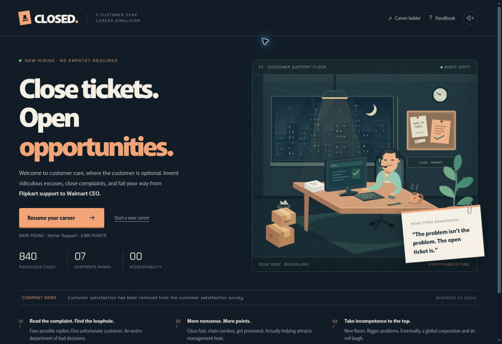

# Avoid Flipkart

An independent, evidence-led customer account of delivery delays and support correspondence. The documented casebook is a buildless static website made with HTML, CSS and progressive JavaScript; the airport and product images are illustrations. The browser game adds dependency-free JavaScript.

## Core casebook

The root page opens with a satirical editorial cover, a short factual summary and a filterable five-order arrival board. The corporate-to-human phrasebook explicitly labels its translations as satire. Unique section links connect the highlights, individual order files, correspondence, verdict, practical answers and source notes. The record remains dated **6 November 2026**; this is historical reporting, not live tracking.

`index.html` contains the complete readable account. `styles.css` supplies the responsive navy, pale-paper and amber design. `site.js` progressively adds board filters, phrasebook cycling, reading progress and manual sharing; the article and native disclosures work without JavaScript. `index.md` is the synchronized Markdown edition, and `api/summary.js` and `api/mcp.js` expose the factual record. Thirty days for the Microsoft licences means order-to-reported-delivery time; it is not a lateness claim.

## CLOSED. — the game

**Play at [avoidflipkart.com/game/](https://avoidflipkart.com/game/).** The original casebook remains at the site root. The former support-chat demo has been replaced by an entry into the full game.

CLOSED is a deliberately backwards customer-care career simulator: increasingly ridiculous excuses earn corporate approval; actually helping a customer loses points and raises management heat. All game cases, people, dialogue and policies are fictional satire, separate from the documented casebook.

The game uses the site's original navy, blue and yellow palette. An original, generated retro cartoon cast introduces the support agent, HR officer and executive; the playable workspace is a desktop monitor containing a support inbox. Read the customer's message, inspect the evidence and choose the reply you want to send. The employee sidebar, case references, internal memos and sent-message receipts keep the interaction inside that fictional workplace.

### Two career modes

Both modes follow seven ranks: **Customer Care Executive → Senior Support Executive → Team Lead → Grievance Officer → Operations Director → Flipkart CEO → Walmart CEO.**

| Mode | Cases | Progression and finish |
| --- | --- | --- |
| **Express** | 14 curated conversations: two at each rank, with 56 individually written replies | Advances after two handled cases at each rank, independently of score. Survive any HR review to finish the fourteen-case career. |
| **Full Career** | 840 playable cases: 120 per rank | Promotions require approval points and lifetime closed-case quotas. The final celebration follows 20 cases at Walmart CEO; endless play remains available afterward. |

The full library contains 20 original situations per rank, each with six separately authored developments and evidence records. Developments are self-contained. Full Career deals a seeded, shuffled queue without repeats until that rank's 120-case deck is exhausted.

The supplied creative reference contains illustrative incidents and generation matrices, rather than 750 fully expanded records. Selected premises were adapted into original conversations and developments. See [the content notes](game/CONTENT.md) for the library structure, Express selections and provenance.

### Replies, points and HR

All four reply options use the same visual treatment. Their category, base points and consequences are hidden until a reply is sent, and positions are deterministically shuffled. The customer-facing prose carries the decision; an answer badge does not give it away.

- Ridiculous closures earn approval points and cool management heat. The most outrageous response earns the highest base reward. Helpful responses cost points and raise heat.
- Fast closures within 25 seconds earn speed bonuses and build a multiplier up to ×3. Taking longer never fails a case; it only forfeits the speed bonus. The clock stops while reading the outcome.
- At **100% management heat**, HR calls a review with **three questions**. All three answers are collected before the verdict. Any empathetic answer results in being fired and ends the run; passing all three resets heat to zero and lets the career continue. Answer options receive the same neutral presentation as ordinary replies. A pending review is resolved before a promotion or final victory.
- Ten-case shifts carry rotating management memos and performance reviews. Achievements, a recent-case record, stamp effects and optional synthesized sound accompany progress. Scores cannot fall below zero.

### Controls

| Control | Action |
| --- | --- |
| Click/tap a reply, or **1–4** | Respond to a customer case |
| Click/tap an HR reply, or **1–3** | Answer the current HR question |
| **Enter** on the result screen | Continue |
| **P** | Pause/resume |
| **M** | Toggle sound |
| **?** | Open the handbook |
| **Escape** | Close a dialog |

Switching away from the tab pauses the timer. Returning requires an explicit resume, so reading time is never silently consumed in the background. Native dialogs, visible keyboard focus, descriptive artwork labels and reduced-motion support are used throughout.

### Saves and sharing

Express and Full Career have separate automatic browser saves under `closed-career-v2:express` and `closed-career-v2:full`. Valid version 1 careers migrate into Full Career without rescoring their history. Save restoration validates case IDs, scoring and HR progress; an in-progress review, final report or completed Express run can be restored. Restarting a mode requires confirmation and leaves the other mode's progress intact.

The share panel provides a prefilled X post composer, the device's share sheet where available, a copyable challenge and a downloadable **1200 × 630 PNG** result card. Express challenge links carry the mode and seed; a friend's score and save remain their own. If clipboard access is unavailable, the challenge appears in a selectable text field. Sharing never automatically publishes a post.

Gameplay has no backend, account, purchases, analytics, external AI calls or external asset dependencies. Artwork and fonts are served locally, optional sound is synthesized in the browser, and progress stays in the current browser.

## Run locally

From a checkout of this repository, run `python -m http.server 4173` and open `http://localhost:4173/`. No package installation or build step is needed.

Alternatively, with Node.js 22 or newer, use `npm run dev` and open the printed URL. The development server accepts `--host` and `--port` arguments, e.g. `npm run dev -- --port 4173`. Visit `/game/` for the game. The local static servers do not emulate Vercel's serverless API or content-negotiation proxy.

For responsive layout checks, open `/docs/layout-preview.html` on the local server. Its same-origin frame offers 360, 390, 768 and 1280 pixel widths. This developer page is marked `noindex` and is not linked from the public navigation.

### Verify

Run `npm test` with Node.js 22 or newer. No dependency installation is needed for the game or its tests. The built-in Node test runner checks the complete case library, Express curation, reply prose without scoring hints, scoring, combos, management heat, promotions, no-repeat dealing, shift reviews, achievements, final victory, three-question HR reviews, termination, separate career modes and version 1 save migration. The existing Vercel deployment workflow runs these tests before building and deploying a push to `main`.

### Game source

| File | Responsibility |
| --- | --- |
| `game/index.html` | Game entry point, document metadata and dialog shell |
| `game/content.js` | Scenarios, developments, replies, rank definitions, Express selections and tips |
| `game/reference-cases.js` | Original reference-inspired conversations and replacement scenario developments |
| `game/CONTENT.md` | Case counts, curation, provenance, metadata and content conventions |
| `game/engine.js` | Pure state transitions, modes, seeded dealing, HR verdicts and validated save migration |
| `game/app.js` | Monitor/inbox rendering, active-time tracking, separate saves, dialogs, input and manual sharing |
| `game/game.css` | Responsive blue/yellow interface, monitor shell, equal reply buttons and feedback |
| `game/scene.js`, `game/scene.css` | Cast rendering, consistent portrait crops and office/HR reactions |
| `game/assets/closed-office-crew*.webp` | Local original cartoon artwork in full and responsive sizes |
| `game/assets/ART_DIRECTION.md` | Artwork provenance, visual direction and scene API |
| `game/audio.js` | Optional, locally synthesized effects |
| `game/social.png`, `game/social.svg` | Game-specific social preview artwork |
| `game/*.test.js` | Dependency-free content and engine regression tests |
| `docs/closed-preview.jpg` | Screenshot used in this README |

Adding a new scenario requires six distinct `development | evidence` entries and meaningful case-specific replies. Content tests enforce 120 cases per rank, unique IDs and complaints, complete choices, readable prose, two curated Express cases per rank and the intended scoring direction. Preserve stable case and choice IDs so saved careers continue to work. Breaking changes to saved state need a versioned migration, with tests covering pending results and HR reviews as well as active cases.

## Deploy and search metadata

The site is published at `https://avoidflipkart.com/`. The canonical URL, Open Graph/Twitter card (`og-image.jpg`, 1200×630), connected `WebSite`, `WebPage`, `Article` and `Organization` structured data, `sitemap.xml` and `robots.txt` all use that address; update them together if the domain changes. When content changes, update `dateModified`/`article:modified_time` in `index.html` and `lastmod` in `sitemap.xml`. After deployment, submit the sitemap in Google Search Console and Bing Webmaster Tools. Indexing and ranking are controlled by search engines.

`/index.html` permanently redirects to `/`. The Markdown edition has an HTTP canonical link to the HTML account, and the existing Markdown content-negotiation route remains available. Keep the HTML, Markdown and read-only API facts aligned when updating the record.

The casebook's illustrative images are served as WebP. Their full-resolution source PNGs are kept outside the repository.

The original correspondence, contact details, full order identifiers, and private case notes are not part of this repository. Font licenses are included alongside the self-hosted fonts in `assets/fonts/`.
